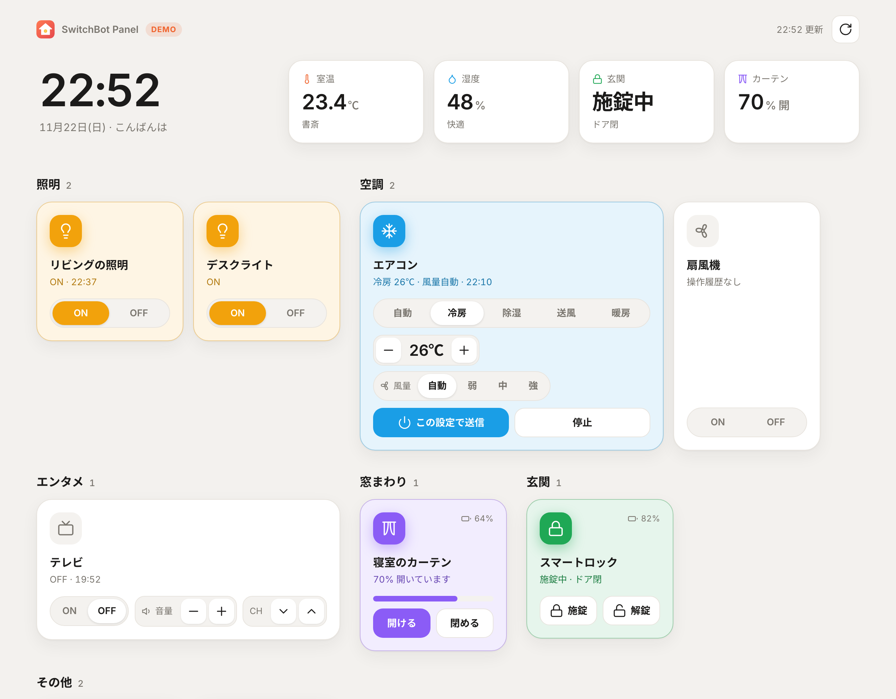

# SwitchBot Panel

SwitchBot の家電を、PC やタブレットのブラウザから操作するためのセルフホスト Web パネルです。
自分の PC で小さなサーバーを動かし、[SwitchBot API v1.1](https://github.com/OpenWonderLabs/SwitchBotAPI) を中継します。



> [!WARNING]
> **非公式のツールです。** SwitchBot の開発・販売元とは関係がなく、動作は保証されません。
> スマートロックなど住まいの安全に関わる機器も操作できるため、**ご利用は自己責任でお願いします**（[免責事項](#免責事項)）。

## 特長

- **依存パッケージなし**：Node.js 22 以上だけで動きます（`npm install` 不要）
- **トークンはサーバー側だけで保持**：API の署名（HMAC-SHA256）はサーバーで行い、ブラウザにトークンを渡しません
- **スマートホーム風の画面**：照明・空調・エンタメ・窓まわり・玄関にカテゴリ分けし、ON の家電はタイルが色付きで光ります
- **室温・湿度・施錠状態をひと目で**：温湿度計、スマートロック、カーテンの状態を上部にまとめて表示します
- **赤外線リモコンの状態も記憶**：状態を取得できない赤外線家電は、このパネルから最後に送った操作を覚えて表示します（複数の端末で共有）
- **誤操作の防止**：解錠は 2 回押したときだけ実行されます。`DISABLE_UNLOCK=1` で解錠そのものを無効にできます
- **デモモード**：トークンがなくても、ダミーデータで画面を試せます
- ライト / ダークモード、PC・タブレット・スマホの画面幅に対応しています

## 必要なもの

- Node.js 22 以上
- SwitchBot アプリのアカウントと、操作したい SwitchBot デバイス
- 赤外線家電や Bluetooth のデバイスをクラウドから操作するには、SwitchBot ハブ（Hub Mini / Hub 2 など）が必要です

## まずはデモで試す

トークンは不要です。実際の家電には一切アクセスしません。

```sh
git clone https://github.com/bswitchQrb/switchbot-panel.git
cd switchbot-panel
DEMO=1 npm start
```

ブラウザで http://127.0.0.1:8787/ を開いてください。

## セットアップ

### 1. トークンとシークレットを取得する

1. SwitchBot アプリで「プロフィール」→「設定」→「基本データ」を開く
2. 「アプリバージョン」を 10 回タップすると「開発者向けオプション」が表示される
3. 「トークン」と「クライアントシークレット」を控える

> [!CAUTION]
> トークンとシークレットがあれば、あなたのすべての SwitchBot デバイスを操作できます。他人に見せたり、Git にコミットしたりしないでください。

### 2. `.env` を作成する

```sh
cp .env.example .env
chmod 600 .env
```

`.env` を開いて、`SWITCHBOT_TOKEN` と `SWITCHBOT_SECRET` を書き込みます。

### 3. 起動する

```sh
npm start
```

http://127.0.0.1:8787/ を開くと、アカウントに登録されているデバイスが表示されます。
表示されない場合は、SwitchBot アプリでデバイスの「クラウドサービス」が有効になっているか確認してください。

## 設定

`.env`（または環境変数）で設定します。

| 変数 | 既定値 | 説明 |
|---|---|---|
| `SWITCHBOT_TOKEN` | — | SwitchBot アプリのトークン（必須。デモモードでは不要） |
| `SWITCHBOT_SECRET` | — | SwitchBot アプリのクライアントシークレット（必須。デモモードでは不要） |
| `HOST` | `127.0.0.1` | 待ち受けるアドレス |
| `PORT` | `8787` | 待ち受けるポート |
| `DISABLE_UNLOCK` | `0` | `1` にするとスマートロックの解錠を無効にします（サーバー側で拒否） |
| `DEMO` | `0` | `1` にするとダミーデータで動作します |

## 他の端末から使う

既定ではサーバーを動かしている PC からしか開けません。
スマホやタブレットからも使いたい場合は、[Tailscale](https://tailscale.com/) などの VPN を使い、`HOST` にその VPN の IP アドレスを指定するのがおすすめです。
自分の端末だけが接続でき、外出先からも使えます。

> [!WARNING]
> **インターネットに公開しないでください。** このパネルには認証機能がありません。
> `HOST=0.0.0.0` にすると、同じネットワークにいる誰でも家電を操作できるようになります。

## 対応デバイス

| 種類 | できること |
|---|---|
| 赤外線リモコン：エアコン | 運転・停止、モード（自動 / 冷房 / 除湿 / 送風 / 暖房）、温度、風量 |
| 赤外線リモコン：テレビ | 電源、音量、チャンネル |
| 赤外線リモコン：照明・扇風機・その他（DIY を含む） | ON / OFF |
| スマートロック | 施錠・解錠、施錠とドアの状態、電池残量 |
| カーテン / ブラインド | 開ける・閉める、開き具合 |
| ボット | 押す（スイッチモードでは ON / OFF） |
| プラグ・電球・テープライトなど | ON / OFF、状態 |
| 温湿度計 | 室温・湿度を上部に表示 |

ハブ、キーパッドなど操作する項目がないデバイスは表示しません（電池残量が 20% を下回ると上部に警告を表示します）。
すべての機種で動作を確認したわけではありません。

## しくみ

```
ブラウザ ──▶ server.mjs（自分の PC）──▶ SwitchBot API v1.1
               ├ トークンで署名（HMAC-SHA256）
               ├ デバイス一覧を 1 分キャッシュ
               └ 赤外線家電の最後の操作を state.json に保存
```

- 状態は 5 分ごと、およびタブに戻ったときに自動で更新します（SwitchBot API の上限は 1 日 10,000 回です）
- 他のサイトから家電を操作されないよう、POST は同一オリジンからのリクエストだけを受け付けます
- 画面のフォントを Google Fonts から読み込むため、画面を開くと Google のサーバーにリクエストが送られます

## 常駐させる（macOS）

ログイン時に自動で起動する launchd の設定例を [`examples/local.switchbot-panel.plist`](examples/local.switchbot-panel.plist) に置いています。

## 免責事項

- このソフトウェアは非公式のものであり、SwitchBot の開発・販売元とは一切関係がなく、承認や保証を受けたものではありません。
- このソフトウェアは「現状のまま」提供され、明示・黙示を問わず、いかなる保証もありません。
- このソフトウェアを利用したことによって生じた損害（家電の誤作動、施錠・解錠に関わるトラブル、API の利用制限、トークンの漏えいなどを含む）について、作者は一切の責任を負いません。
- SwitchBot API の仕様変更により、予告なく動作しなくなる可能性があります。
- SwitchBot API の利用にあたっては、SwitchBot の利用規約に従ってください。

## ライセンス

[MIT License](LICENSE)

アイコン（Lucide）やフォントなど、第三者の成果物のライセンスは [THIRD_PARTY_NOTICES.md](THIRD_PARTY_NOTICES.md) を参照してください。
「SwitchBot」は、その権利者の商標または登録商標です。
